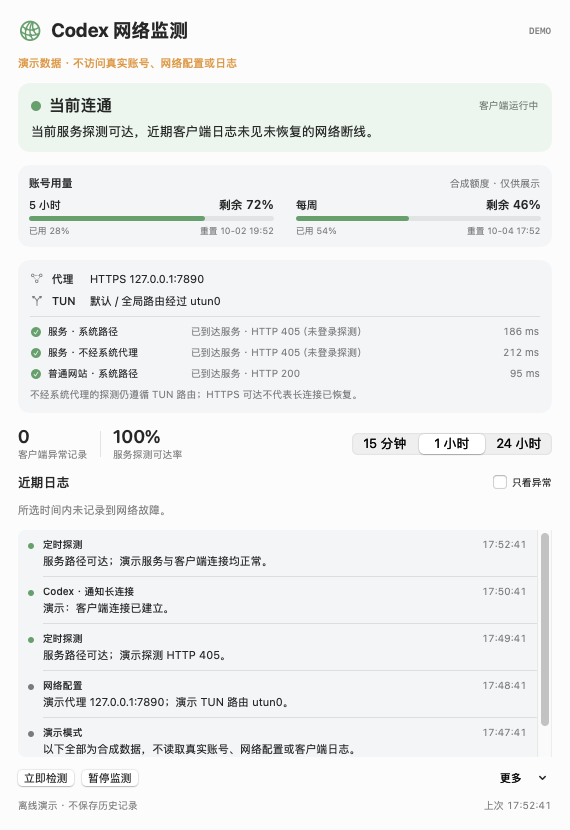
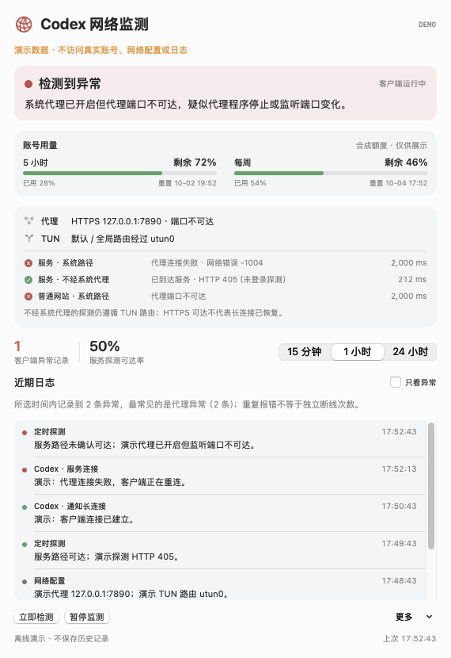

# Codex Network Monitor · Codex 网络监测

[English](README.md) | **简体中文**

一个轻量的 macOS 菜单栏工具，持续检查 Codex 的网络路径、客户端断线记录，以及账号的 **5 小时 / 每周剩余额度**。

> 独立社区项目，与 OpenAI 无隶属关系。界面目前为中文；文档提供中英文版本。

## 界面展示

以下截图由真实应用的 **离线演示模式** 渲染。额度、代理端口、接口、时间和日志均为合成示例，不是作者的账号或网络记录。

| 连通状态与额度 | 代理异常与原因总结 |
| --- | --- |
|  |  |

## 功能

- 菜单栏常驻：彩色状态灯，以及 `5h余…% 周余…%`。
- 单击查看面板，右键快速检测、暂停或退出；也可打开独立窗口。
- 每 15 秒检查服务路径；结合当前 Codex 进程的日志识别尚未恢复的连接故障。
- 查看系统 HTTP / HTTPS / SOCKS 代理、监听端口和 PAC 开关，识别 IPv4 / IPv6 默认或全局 TUN 路由。
- 对比系统路径、不经系统代理的服务探测、普通网站探测，给出一句话的本地诊断。
- 每分钟读取账号额度：剩余比例、已用比例和重置时间；旧数据标记 `*`，缺失值显示未知。
- 15 分钟 / 1 小时 / 24 小时日志筛选、只看异常、复制总结及导出；最长保留 7 天 / 20,000 条。
- 可选断线 / 恢复通知，默认关闭；休眠期间不计作断线，唤醒后重新检查。

| 状态 | 含义 |
| --- | --- |
| 🟢 连通 | 服务探测可达，当前可读日志中没有尚未恢复的已识别连接故障。 |
| 🔴 异常 | 服务路径异常，或日志中仍有可信的近期连接故障。 |
| ⚪ 未确认 | 初始化、暂停、休眠、客户端未运行、403 探测受限、日志不可读，或断线证据过期。 |

## 安装

需要 **macOS 14 或更高版本**，并已安装、登录 Codex。

1. 从 [Releases](https://github.com/landrarwolf/CodexNetworkMonitor/releases/latest) 下载匹配架构的 ZIP：Apple Silicon 用 `arm64`，Intel 用 `x86_64`。
2. 解压，将 `Codex Network Monitor.app` 拖入“应用程序”，然后启动。
3. 在菜单栏查看状态与额度。需要自动启动时，可自行加入“系统设置 → 通用 → 登录项与扩展”。

发布包使用临时签名，尚未使用 Apple Developer ID 签名或公证。若 macOS 阻止打开，请按 [Apple 的说明](https://support.apple.com/102445) 在系统设置中自行审核并批准；项目不要求关闭 Gatekeeper、证书校验或其他系统保护。

## 从源码构建

需要带 Swift Testing 的 **Swift 6+** 工具链，可使用近期 Xcode 或 Command Line Tools；没有第三方包依赖。

```sh
git clone https://github.com/landrarwolf/CodexNetworkMonitor.git
cd CodexNetworkMonitor
zsh test.sh
zsh build.sh
open "dist/Codex Network Monitor.app"
```

应用和按架构命名的 ZIP 位于 `dist/`。构建与测试缓存默认位于系统临时目录，避免文件同步服务附加 Finder 元数据造成签名失败；两个脚本均可接收缓存目录作为第一个参数。签名及 ZIP 打包在临时目录完成，归档不携带 Finder 扩展属性。

## 诊断与截图

```sh
# 以下两项会检查真实网络 / 账号；不要直接将输出作为公开截图。
"dist/Codex Network Monitor.app/Contents/MacOS/CodexNetworkMonitor" --diagnose
"dist/Codex Network Monitor.app/Contents/MacOS/CodexNetworkMonitor" --usage-diagnose

# 使用完全离线的合成数据重新生成 README 截图。
zsh scripts/screenshots.sh
```

`--demo healthy|proxy --show-window` 可交互查看演示界面；`--render-preview PATH` 保存当前界面的 PNG 后退出，配合 `--demo` 才适合公开。演示模式不创建真实历史存储、不启动网络检测或 CLI、不读取客户端日志，也不申请通知权限。`--demo` 与真实诊断参数互斥。

`--data-dir PATH` 指定本地数据目录；`--show-window` 启动时打开独立窗口。关闭窗口后菜单栏监测继续运行。

## 数据与隐私

- 用量通过已安装 Codex CLI 的 [app-server](https://learn.chatgpt.com/docs/app-server) 接口读取，只发送 `initialize`、`initialized` 和 `account/rateLimits/read`。不生成模型回复、不购买额度、不兑换重置。
- 使用 CLI 的现有登录状态；本程序不读取认证文件正文、不复制认证文件、不要求 API Key。归一化额度仅保存在内存中，不保存账号 ID、余额或认证消息。
- 原始客户端日志的位置见 [官方排障文档](https://learn.chatgpt.com/docs/reference/troubleshooting)。程序只输出受控的错误类别与摘要，不复制原始聊天、令牌、请求正文或完整日志行。
- 本地 `history.jsonl` 位于 `~/Library/Application Support/Codex Network Monitor/`，其中网络配置记录可能包含本机代理地址和 TUN 接口名称。分享前仍应审核；项目不自动上传历史。
- CLI 运行目录是该目录下的 `codex-runtime`；启动时关闭调试输出和分析上报。本工具不修改代理、TUN、证书、Codex 配置或登录项。
- 仓库只收录源码、文档、测试与合成截图；发布前检查会拦截常见凭据、私有路径、历史文件、构建产物和 PNG 隐私元数据。检查不能代替人工审核图片像素和 Git 历史。

## 诊断边界

主探测是未登录的 HEAD 请求，目标为 `https://chatgpt.com/backend-api/codex/responses`。401 / 404 / 405 表示到达 HTTP 服务；403 保留为未确认；407、429 和全部 5xx 视为异常。普通网站探测使用 Apple 测试页面。辅助探测在正常情况下约每分钟执行，故障或配置变化时立即执行。

HTTPS 可达不能证明 Codex 的 WebSocket / 流式请求已恢复；只有对应客户端恢复记录才能清除已识别故障。超过 24 小时或日志不可读的旧断线证据显示灰灯，不擅自推断恢复。未知自定义远端的错误只进入灰色历史记录，不直接控制核心连接红灯。

不经系统代理的请求仍遵循 TUN 路由，不能证明绕过了 VPN。系统代理配置不一定等于 Codex 实际使用的代理路径；PAC 仅检测开关，不解析脚本。原因由本地规则推断，不能确证时会标注疑似或未确认。

首次读取每个日志文件最多尾部 2 MB，选取近期 12 个文件并加上当前进程的文件；历史不是完整原始日志。每条异常记录不等于一次独立断线。日志规则已针对客户端 `26.928.31416` 检查，客户端更改格式后可能需要调整。

## 维护与贡献

```sh
python3 scripts/check_public.py --self-test
python3 scripts/check_public.py
```

第二项检查 Git 已跟踪 / 已暂存文件；在提交新文件前先 `git add`，再运行检查。CI 在 Apple Silicon 和 Intel 的 macOS 环境测试并构建。贡献与问题报告请见 [CONTRIBUTING.md](CONTRIBUTING.md)，版本记录见 [CHANGELOG.md](CHANGELOG.md)。

采用 [MIT License](LICENSE)。
